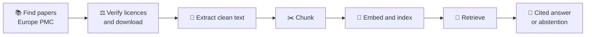

<div align="center">

# 🔬 EvidenceRAG

### A local-first research assistant that answers from biomedical papers — with citations, or not at all.


</div>

---

## ✨ What it does

Ask a question about the research literature. EvidenceRAG searches a corpus of licence-verified papers, hands the most relevant passages to a local language model, and returns an answer where **every claim cites its source** — or says plainly that **the evidence isn't there**.

```text
$ uv run python scripts/ask.py "What was the serum half-life of DyAb-designed antibodies in mice?"

Status: abstained_by_model (top retrieval score 0.784)

I cannot answer this from the provided sources. The sources do not mention
the serum half-life of DyAb-designed antibodies in mice.
```

Knowing when *not* to answer is a feature, not a failure.

## 🧭 Principles

- 🏠 **Local and free** — runs offline on a laptop after the initial downloads. No paid APIs.
- ⚖️ **Licences verified, not assumed** — every paper's licence is checked against the article itself. Article text is never published.
- 🔗 **Traceable** — every cited passage leads back to its paper, its licence and the exact verified file.
- 📏 **Measured** — decisions are backed by data, and results are reported with the conditions that produced them.

## ⚙️ How it works



| Stage | Approach |
|---|---|
| Corpus | Open-access papers from Europe PMC, licence-verified from each article's own XML |
| Extraction | Sections classified by content, not position; references and admin sections excluded |
| Chunking | ~300-word, section-aware chunks with title and section context |
| Retrieval | `bge-small-en-v1.5` embeddings, exact FAISS search |
| Generation | Qwen3 8B via Ollama, numbered sources, strict grounding rules |
| Abstention | Off-topic threshold **and** model-level refusal for unanswerable questions |

## 📊 Results so far

Evaluated on **LitQA2**, an expert-written benchmark of questions about recent biology papers, using the 38-question tuning split.

| Mode | Accuracy | Precision | What it tests |
|---|---|---|---|
| 🔎 **With retrieval** (hybrid, 8 passages) | **90%** | **96%** | Finding and using the right evidence |
| 🚫 **Source paper removed** | — | — | Declined **51 / 51** — no invented answers |
| 🧠 **Closed book** (no sources) | 16% | 36% | What the model knows from memory |

Hybrid retrieval (keyword + embedding search) and retrieving 8 passages instead of 5 raised accuracy from 78% to 90% over the original embedding-only baseline, mainly by finding the passage containing the answer far more often (78% → 96%).

> **Read this carefully:** these numbers come from a closed corpus of 138 papers that contains each question's source paper. They are **not** comparable with open-literature LitQA2 results, where the right paper must first be found among millions. Details in the [report](docs/REPORT.md#13-baseline-results).

## 🗺️ Progress

| | Module | Status |
|---|---|---|
| 0 | Environment and repository | ✅ |
| 1 | Data ingestion | ✅ |
| 2 | Chunking and indexing | ✅ |
| 3 | Retrieval and benchmarking | 🚧 hybrid search next |
| 4 | Grounded answers with citations and abstention | ✅ |
| 5 | Evaluation | 🚧 baseline measured |
| 6 | API | 📋 |
| 7 | User interface | 📋 |
| 8 | Packaging, Docker, CI | 📋 |
| 9 | Cloud deployment (GCP) | 💤 optional |

Full checklist: **[docs/ROADMAP.md](docs/ROADMAP.md)**

## 🚀 Quickstart

**Requirements:** Python 3.12, [`uv`](https://docs.astral.sh/uv/), and [Ollama](https://ollama.com) with the model pulled (`ollama pull qwen3:8b`). A GPU is recommended.

```bash
git clone git@github.com:mrbounatsos/evidence-rag-assistant.git
cd evidence-rag-assistant
uv sync --extra gpu

# Build the corpus (downloads and verifies papers)
uv run python scripts/discover_europe_pmc.py
uv run python scripts/download_litqa2.py
uv run python scripts/resolve_litqa2.py
uv run python scripts/fetch_fulltext.py

# Extract, chunk and index
uv run python scripts/extract_text.py
uv run python scripts/build_chunks.py
uv run python scripts/build_index.py

# Ask
uv run python scripts/ask.py "How does DyAb predict antibody properties with little data?"
```

**Evaluate** on the LitQA2 tuning split:

```bash
uv run python scripts/build_litqa2_benchmark.py
uv run python scripts/evaluate_litqa2.py --split tune
```

> **Running under WSL?** Long evaluation runs can exhaust memory through Ollama's prompt cache. Disable it in the Ollama service configuration with `LLAMA_ARG_CACHE_RAM=0`.

## 📁 Repository layout

```text
src/evidence_rag_assistant/
    ingestion/     finding papers, verifying licences, extracting text
    indexing/      chunking and embeddings
    retrieval/     searching the index
    generation/    grounded answers with citations
    evaluation/    LitQA2 benchmark harness
scripts/           one entry point per pipeline step
tests/             offline tests built from real-data patterns
notebooks/         decisions, with the evidence behind them
docs/              report and roadmap
```

## 🐳 Run with Docker

The API and the model server run as two containers. The corpus and index are built locally first (see Quickstart) and mounted read-only.

```bash
docker compose up -d
docker compose exec ollama ollama pull qwen3:8b   # first run only
curl -s localhost:8000/health
```

Interactive API documentation: http://localhost:8000/docs

## 📖 Documentation

- **[Report](docs/REPORT.md)** — the ideas, decisions and methods behind every part of the system
- **[Roadmap](docs/ROADMAP.md)** — progress and what comes next
- **[Ingestion decisions notebook](notebooks/01_ingestion_decisions.ipynb)** — each data decision with its evidence

## 🙏 Acknowledgements

- [Europe PMC](https://europepmc.org) for open access to the biomedical literature
- [FutureHouse](https://www.futurehouse.org) for LitQA2 ([LAB-Bench](https://huggingface.co/datasets/futurehouse/lab-bench), CC BY-SA 4.0)
- [BAAI](https://huggingface.co/BAAI/bge-small-en-v1.5) for the BGE embedding models, and the [Qwen](https://github.com/QwenLM) team for Qwen3

Article texts and benchmark data are used locally under their respective licences and are not redistributed in this repository.