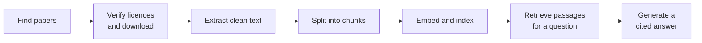

# EvidenceRAG — Project Report

**Status as of 21 October 2026:** the system answers questions end to end — from verified research papers to cited answers — and a first evaluation has established a baseline. Hybrid retrieval is the next planned step.

This report explains the ideas behind EvidenceRAG, the decisions taken while building it, and the methods used to check that those decisions were right. Implementation details are left to the code; only technicalities that shaped a decision are kept here.

---

## Contents

1. [Goal and guiding principles](#1-goal-and-guiding-principles)
2. [How the system works](#2-how-the-system-works)
3. [Building a trustworthy corpus](#3-building-a-trustworthy-corpus)
4. [Turning papers into searchable text](#4-turning-papers-into-searchable-text)
5. [Documenting decisions with evidence](#5-documenting-decisions-with-evidence)
6. [Chunking](#6-chunking)
7. [Retrieval](#7-retrieval)
8. [Grounded answers: citations and abstention](#8-grounded-answers-citations-and-abstention)
9. [Changing course: end to end first](#9-changing-course-end-to-end-first)
10. [Choosing a benchmark](#10-choosing-a-benchmark)
11. [Evaluation methodology](#11-evaluation-methodology)
12. [An operational problem: running out of memory](#12-an-operational-problem-running-out-of-memory)
13. [Baseline results](#13-baseline-results)
14. [What the failures teach](#14-what-the-failures-teach)
15. [Known limitations](#15-known-limitations)
16. [Decision summary](#16-decision-summary)
17. [Next steps](#17-next-steps)
18. [References](#18-references)

---

## 1. Goal and guiding principles

EvidenceRAG is a **biomedical research assistant** built on retrieval-augmented generation (RAG). Given a question, it searches a collection of research papers, passes the most relevant passages to a language model, and returns an answer that cites its sources — or says plainly that the evidence is not sufficient.

It is a public portfolio project, meant to demonstrate GenAI engineering in practice, and to be an honest record of how such a system is built. Six principles guided the work:

- **Local and free.** Once data and models are downloaded, everything runs offline on a laptop: a local language model (Qwen3 8B) and a local embedding model. No paid API is involved.
- **Licensing is correctness, not paperwork.** "Open access" does not automatically mean "free to reuse". Every paper's licence is verified, and article text is never published.
- **Provenance everywhere.** Any passage the model sees can be traced to its paper, its licence and the exact file it came from.
- **Evidence before decisions.** Rules are derived from inspecting real data, and later from benchmark measurements — not from assumptions about how data should look.
- **Honest reporting.** Every result is stated together with the conditions that produced it.
- **Working system first, refinement second.** Improvements are made where measurements show they matter.

---

## 2. How the system works

The system is a chain of stages, each producing an inspectable output for the next:

Keeping the stages separate was a deliberate choice. Each stage can be re-run, inspected and tested on its own, and an experiment on a later stage — say, a different chunk size — does not require repeating the earlier ones.

---

## 3. Building a trustworthy corpus

### Where the papers come from

Papers come from **Europe PMC**, a public archive of biomedical literature with an official API, licence information per article, and full text for many open-access papers in a standard XML format (JATS). The initial corpus was 50 papers on antibody design and protein structure prediction.

### What may be published

The first real decision was what the public repository may contain, because that decides how strict licensing must be. The choice was **code only**: the repository holds code, documentation and benchmarks that refer to papers by identifier, while article text — and everything derived from it, such as chunks and indexes — stays on the local machine. Anyone cloning the project re-downloads the papers themselves.

Under that model, all Creative Commons licences permit the intended use, including non-commercial and no-derivatives variants. Papers with a missing or unrecognized licence are excluded.

### The article is the authority, not the index

Europe PMC's search results include a licence for each paper, but that is index metadata — a summary. The legally relevant statement is the licence inside the article itself. So the system uses the index only as a first filter, and makes the final decision from each article's own text. Three rules follow:

- **Verify before storing.** A paper is downloaded into memory, its licence is checked, and only then is it written to disk.
- **Record every attempt,** including failures, with the reason, so every exclusion can be explained later.
- **Fingerprint every file** with a hash, so it can later be proven that text came from exactly the verified file.

### Lesson: one standard, many interpretations

The first licence check rejected 6 of 50 papers. Inspection showed they were not missing a licence: different publishers place the licence link in different spots within the same XML standard. One publisher hid it inside a nested link element that the first version of the parser never looked at. Fixing that recovered 5 papers, and every publisher pattern found became an automated test.

The sixth paper stated its licence only as an abbreviation in prose ("CC-BY-NC-ND 4.0"), with no machine-readable link. The decision was to keep excluding it. A licence check should **fail closed**: wrongly excluding one paper costs little, wrongly including a paper of uncertain status costs a lot — and every extra rule in a licence check is something that must be tested and defended.

**Result:** 49 of 50 papers verified, and the index licence agreed with the article's own licence in every case that could be checked.

---

## 4. Turning papers into searchable text

### Why this step matters

A RAG system can only answer from what its search returns, and the search can only return what was put into the corpus. A paper's XML contains far more than its argument: reference lists, funding statements, author contributions, formatting markup. A reference-list entry is short and full of topical words, so it can match a question extremely well — and the model may then cite the title of some other paper as if it were evidence. Extraction is about deciding what is worth searching.

### Lesson: real data ignores the textbook

The XML standard places back matter (references, acknowledgments, funding) in its own section, separate from the body. The obvious rule was "take the body, skip the back matter". A survey of the corpus showed this would fail: **in about half the papers, the back matter sits inside the body**, mixed in with the content. Some papers also start with untitled paragraphs that turn out to be the introduction.

So the decision was to judge each section by **what it is, not where it is**, using three signals in order of reliability:

1. **Its contents** — a section holding a reference list is references, whatever it is called.
2. **Its type label**, where the publisher provides one.
3. **Its title**, normalized for spelling and numbering, matched against a list built from surveying the corpus itself.

**Kept:** title, abstract, body sections with their section headings, figure captions, and untitled opening paragraphs.
**Skipped:** references, acknowledgments, funding and conflict statements, author contributions, data-availability notes, supplementary-material links, and similar administrative sections.

### Lesson: clean text needs care

Reading the extracted text revealed problems invisible in counts:

- **Words split apart** where part of a word was formatted (bold or italic), because text fragments were joined with spaces.
- **Stray citation numbers** ("worldwide, 1 , 2 data") left behind by numbered references. These were removed at the source by dropping the citation elements, rather than by deleting numbers afterwards — which could not tell a citation "7" from "7 mutations". Author-year citations were kept, because they are part of the sentence.
- **LaTeX code inside formulas**: some formulas carried a full LaTeX document alongside a readable version, polluting paragraphs with markup. Only the readable version is kept.

### Method: audit everything, including what you keep

Every element the extractor leaves out is recorded with the reason, including anything it has no rule for. That makes exclusions reviewable rather than silent.

The audit has a blind spot, though: it shows what was dropped, not what was wrongly **kept**. That side was checked separately, by surveying the kept sections. Doing so found three administrative sections that had slipped into the corpus because each appeared in only one paper. The general lesson: a check that only looks at frequent cases cannot see rare ones.

---

## 5. Documenting decisions with evidence

Because so many decisions came from inspecting data, they were recorded in a notebook following one pattern: **question → evidence → decision**. For example: *Can the index licence be trusted? → comparison of index and article licences across the corpus → the article's licence decides.* The notebook covers eight such findings, from licensing to the extraction audit.

The aim is that anyone asking "why does it work this way?" can see the data that forced each choice. One safeguard was necessary: notebooks save their outputs, so outputs are stripped automatically on commit, except for cells that only show counts and structure. Article text therefore cannot leak into the public repository through a notebook.

---

## 6. Chunking

A **chunk** is the unit the search compares a question against, and the unit the model receives as evidence. Its size is a trade-off: too small, and a chunk lacks the context to be understood; too large, and it mixes several topics, so it matches nothing precisely.

One technical constraint shaped the choice: the embedding model reads at most about 512 tokens and silently ignores the rest. The rule adopted:

- merge consecutive paragraphs **from the same section** up to about **300 words**, which fits within the limit;
- keep figure captions as separate chunks, since they are self-contained;
- prefix each chunk, for search purposes, with its **paper title and section heading**.

The prefix is a simple idea with a large effect. A paragraph saying "our model improved binding rates" does not mention what the paper is about; with the title and section in front, the search knows which paper and topic it belongs to.

---

## 7. Retrieval

### How the search works

Each chunk is turned into an **embedding**: a list of numbers capturing its meaning, so that texts about similar things end up close together even when they share no words. A question is embedded the same way, and the closest chunks are returned. At this corpus size, an exact search over all chunks takes well under a millisecond.

### Lessons from the first searches

- **Specific questions work well.** A question about one paper returned five passages from exactly that paper and the right sections.
- **Broad questions lack diversity.** A broad question about structure-prediction accuracy returned passages from only two review papers, although the corpus contained 18 papers specifically on the topic. Reviews talk about many methods in general terms, which is exactly what broad questions sound like.
- **Scores are a ranking, not a probability.** An off-topic question ("What is the capital of France?") scored about 0.43, against 0.82–0.87 for real questions. Even unrelated text scores well above zero, so scores can be compared, but not read as "percent relevant".

---

## 8. Grounded answers: citations and abstention

### The prompt

For each question, the model receives the top five passages, numbered, and strict rules: answer only from these sources, cite a source number after every claim, never use outside knowledge, and reply with a fixed sentence when the sources are not enough. The model is set to be as deterministic as possible, so the same question gives the same answer.

Sources are numbered rather than labelled with long identifiers, because short numbers are copied reliably by a model; the numbers are mapped back to papers afterwards.

### Two layers of abstention

Not knowing has two different forms, so it is handled twice:

1. **Off-topic questions** are caught before the model is called: if even the best passage scores below a threshold, the system abstains.
2. **On-topic but unanswerable questions** — about the right subject, but asking something no paper reports — pass that check, because their passages look relevant. Only the model, reading the passages, can notice that they do not contain the answer.

The first test showed why both are needed. "What was the serum half-life of DyAb-designed antibodies in mice?" scored 0.78 — close to genuinely answerable questions — yet the model correctly replied that the sources did not contain the answer.

### Citations are checked, not trusted

Models can cite sources that do not exist, or answer without citing anything. The system checks every citation number, flags invalid ones, and labels an answer without any valid citation as *ungrounded* rather than *answered*.

---

## 9. Changing course: end to end first

After a long period of refining text extraction, it became clear that further polishing could not be justified: without a working system and a benchmark, there was no way to know whether any extraction detail affected answer quality. The project therefore switched strategy — build a simple version of every remaining stage, get the system answering questions, then measure and improve wherever the measurements point.

This reordering also moved retrieval benchmarking behind answer generation, so that both could be evaluated together on the same benchmark.

---

## 10. Choosing a benchmark

### Why a public benchmark

Judging answers by eye, on a handful of hand-picked questions, cannot show whether a change helps. A benchmark needs many questions with known answers and known sources, including some that should be declined. Writing and validating those by hand requires time and expert knowledge, so the search turned to existing, human-validated datasets.

### The choice: LitQA2

**LitQA2** was chosen. It was published by FutureHouse alongside PaperQA2, their own scientific RAG system, and fits this project unusually well:

- **Expert-written and deliberately hard.** Its questions ask about specific findings in recent papers; questions that could be answered from other sources were removed.
- **Full text, not abstracts.** Answers come from the body of papers, which tests the extraction work directly.
- **Each question names its source paper**, so it can be checked whether the search found it.
- **It includes an "insufficient information" option**, matching this system's abstention design.

Alternatives were weaker fits: one widely used biomedical dataset works from abstracts only with yes/no answers; another requires registration and restricts redistribution.

A published study had already used the subset of LitQA2 whose papers are available as full text in Europe PMC — the same source and format as this project — which made the choice easy to integrate and to justify.

### Tuning on one corpus, using on another

The system contains no model weights that are trained here; the language and embedding models are used as they come. What can be tuned are **settings**: chunk size, how many passages to retrieve, the abstention threshold, prompt wording. The plan is to tune those on LitQA2, where answers can be scored, and use the result on the antibody papers.

To make the settings transfer, both sets of papers go into **one shared index**. LitQA2 questions are evaluated against it, so the antibody papers act as realistic distractors — and the system that is tuned is exactly the system later used for antibody questions. The honest claim is "tuned and evaluated on LitQA2, applied to antibody papers"; no measured accuracy is claimed for antibody questions.

### Thinking about data leakage

**Data leakage** means information about the test answers influences how a system is built, so results look better than reality. Three situations were considered:

- **Antibody papers in the index during tuning — not leakage.** They are documents in the knowledge base, which is meant to be visible; no question or answer about them is ever used.
- **Tuning and reporting on the same questions — leakage.** Prevented by splitting the questions once, permanently, into a tuning set and a test set. Decisions are made on tuning results only; the test set is used for final reporting.
- **The model may have seen LitQA2 during its training — possible leakage.** LitQA2 was public before the model was released. This is measured rather than assumed, with a "closed-book" run (see below).

### From dataset to corpus

LitQA2's source papers were looked up in Europe PMC and passed through the same licence verification as every other paper. Of 199 public questions, **89** had all their source papers successfully verified and downloaded. Most losses came from preprints, which the archive lists without full text. The final corpus holds **138 papers** — 89 from LitQA2 and the 49 antibody papers — about 1.1 million words in roughly 6,500 chunks.

The 89 questions were split into **38 for tuning** and **51 for testing**. Answer options are shuffled for each question, and answers are graded by which option was chosen rather than by comparing answer text — which mattered immediately, because the dataset itself contains a misspelled correct answer.

---

## 11. Evaluation methodology

### Three ways to ask each question

| Mode | What the model gets | What a good system does |
|---|---|---|
| **Normal** | The top five passages | Picks the correct answer |
| **Source removed** | The top five passages, with the source paper excluded | Says "insufficient information" |
| **Closed book** | No passages at all | Mostly says "insufficient information"; anything right came from memory |

The **source-removed** mode turns every question into an on-topic unanswerable one, without writing any new questions. It directly tests whether the system invents answers when the evidence is missing.

The **closed-book** mode measures what the model knows on its own. The difference between closed-book and normal performance is what retrieval contributes.

### What is measured

- **Accuracy:** share of questions answered correctly.
- **Precision:** share of *given answers* that are correct. For a system meant to be trusted, this matters most: it answers "when it does answer, how often is it right?"
- **Source hit:** whether the source paper was among the retrieved passages.
- **Key-passage hit:** whether the specific sentence containing the answer was retrieved — approximated by word overlap, since extraction slightly changes text.
- **Diversity:** how many different papers the retrieved passages came from.

Separating retrieval measures from answer measures makes failures diagnosable: when an answer is wrong, it shows whether the search failed to find the evidence or the model failed to use it.

### Making every number traceable

Every evaluation run records its full configuration — models, settings, the exact version of the code and of the corpus — next to its results. Any number can be traced back to what produced it.

---

## 12. An operational problem: running out of memory

The first full evaluation crashed partway, and the answers before the crash were being written very slowly. Systematic diagnosis — checking the model runtime's logs, GPU usage, memory and system messages — ruled out the first hypothesis (the GPU being overloaded) and found the real cause: the model runtime kept a growing cache of past prompts in memory. That cache only helps when prompts repeat, which never happens in an evaluation; it grew until the system ran out of memory, slowing everything down and finally killing the model process.

Disabling the cache fixed both symptoms: generation became about **40 times faster**, and the full evaluation completed without errors. The evaluation was also made resilient: failed requests are retried, and a question that still fails is recorded as an error rather than crashing the run or disappearing from the results.

---

## 13. Baseline results

The baseline was measured on the 38 tuning questions, with the simplest version of every component: embedding search only, five passages per question, 300-word chunks.

| | Normal | Source removed | Closed book |
|---|---|---|---|
| Correct | 32 | 0 | 4 |
| Wrong | 1 | 0 | 5 |
| Declined ("insufficient") | 5 | 38 | 29 |
| **Accuracy** | **84%** | — | 11% |
| **Precision** | **97%** | — | 44% |

Retrieval: the source paper was retrieved for every question (100%); the passage containing the answer was retrieved for 79%.

### What the results show

- **Accurate, and rarely wrong.** When the system answers, it is right 97% of the time — one wrong answer in 38 questions.
- **No invented answers.** With the source paper removed, the system declined every single question.
- **The knowledge comes from retrieval, not from memory.** Closed-book, the model answered only 4 questions correctly. Retrieval accounts for the jump from 11% to 84%, so prior exposure of the model to the benchmark does not explain the result.
- **Evidence makes the model more careful.** Without any passages, the model guessed wrong 5 times; with unrelated passages and strict instructions, it never guessed.
- **The off-topic threshold played no role.** All declines came from the model itself.

### What the results do not show

The LitQA2 authors' system reached 66% accuracy. The 84% here does **not** mean this system is better, because the task here is much easier. Their system had to find the right paper in the entire scientific literature; here, the right paper is guaranteed to be in a corpus of 138, most of which are on unrelated topics. Finding the right paper was trivially easy — it succeeded for every question.

The accurate description is: **84% accuracy on 38 LitQA2 tuning questions, in a closed corpus of 138 papers that contains each question's source paper.**

This also means the benchmark, in its current form, cannot show improvements in finding the right *paper*. The measure with room to grow is finding the right *passage* within it, currently 79%.

---

## 14. What the failures teach

Six tuning questions were not answered correctly. Reading all six was more informative than the totals:

- **Four were retrieval failures:** the right paper was found, but not the passage with the answer. In three of them, the model saw only related information and correctly declined, explaining precisely what was missing.
- **One was the only wrong answer:** the model noticed that the passages did not mention the specific organism group asked about — and then answered anyway, using a value for a broader group. One case is too few to justify changing the instructions; adjusting a prompt to fix a single example risks overfitting to it.
- **Two declined although the answer seemed to be present** — either the model was too literal, or the approximate passage check was fooled. Either way, no wrong answer resulted.

The most useful pattern: **the failing questions hinge on rare, exact terms** — a specific organism group, a mutation code, an exact temperature. Embedding search captures overall meaning and tends to blur such terms, which is how one question received a passage about a related but different group. Keyword search does the opposite: it gives rare terms heavy weight. That is concrete evidence for adding keyword search alongside embedding search (*hybrid retrieval*), with a clear measure — passage retrieval — to show whether it helps.

---

## 15. Known limitations

- **Corpus:** tables, standalone equations, appendices and data-availability statements are not extracted. Licences stated only in prose are rejected by design. One paper is available as abstract only.
- **Retrieval:** embedding search only, weak on rare exact terms; broad questions are dominated by review papers; one paper can supply all retrieved passages.
- **Answers:** citation numbers are validated, but whether a cited passage truly supports its claim is not yet checked automatically. Summary sentences sometimes lack citations.
- **Evaluation:** the closed corpus makes finding the right paper too easy, so results are not comparable with open-literature LitQA2 results. 38 tuning questions can only reveal large differences. The passage check is approximate. The baseline run was not started from fully committed code, and the test set has not been run yet.
- **Operations:** the memory fix lives in the local model runtime's configuration and needs documenting for anyone reproducing the project.

---

## 16. Decision summary

| Decision | Reason |
|---|---|
| Publish code only; keep article text local | Allows every Creative Commons licence; nothing derived from text is published |
| Trust the article's own licence, not the index | The article is the legal statement |
| Fail closed on uncertain licences | Wrongly including a paper costs more than wrongly excluding one |
| Verify before storing; record every attempt; fingerprint files | Every paper and every exclusion is explainable and traceable |
| Classify sections by contents, then type, then title | Half the papers mix back matter into the body |
| Remove citation markers at the source; keep author-year citations | Avoids damaging real numbers; keeps sentences intact |
| Audit both what is dropped and what is kept | Each check alone has a blind spot |
| Record decisions as question → evidence → decision | Every rule can be justified with data |
| ~300-word chunks within sections, with title and section prefix | Fits the embedding model's limit; gives each chunk context |
| Two layers of abstention | Off-topic and on-topic-unanswerable questions need different mechanisms |
| Validate citations; flag unsupported answers | Citations must not be trusted blindly |
| Build end to end before refining | Refinements cannot be judged without measurement |
| LitQA2 as benchmark | Expert-validated, full-text, source-linked, with an abstention option |
| One shared index for benchmark and antibody papers | The tuned system is the system that is used |
| Permanent tuning/test split | Prevents tuning on the questions used for reporting |
| Source-removed and closed-book modes | Test abstention and measure memorization without new questions |
| Grade by chosen option, with shuffled options | Robust to typos in answers; avoids position bias |
| Record configuration with every result | Every number is traceable |

---

## 17. Next steps

1. **Measure the baseline on the test set**, once, without examining individual results.
2. **Add hybrid retrieval** — keyword search combined with embedding search — as motivated by the failure analysis, and compare against the baseline on the tuning set.
3. **Confirm on the test set** if hybrid retrieval improves results.
4. **Further measured experiments:** chunk size, number of passages, limiting passages per paper, the model's reasoning mode, and whether the off-topic threshold is useful.
5. **A harder benchmark setting**, adding papers similar to each source paper, so that finding the right paper becomes a real challenge.
6. **An API and a user interface**, followed by packaging, automated testing and documentation.

---

## 18. References

- Europe PMC: https://europepmc.org
- Laurent et al., *LAB-Bench: Measuring Capabilities of Language Models for Biology Research*, arXiv:2407.10362 (2024)
- Skarlinski et al., *Language agents achieve superhuman synthesis of scientific knowledge* (PaperQA2 and LitQA2), arXiv:2409.13740 (2024)
- LAB-Bench dataset, including LitQA2: https://huggingface.co/datasets/futurehouse/lab-bench (CC BY-SA 4.0)
- Evaluation on the Europe PMC full-text subset of LitQA2: arXiv:2607.28229 (2026)
- BGE embedding models: https://huggingface.co/BAAI/bge-small-en-v1.5