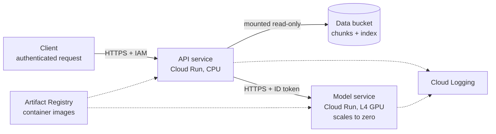

# Deploying EvidenceRAG on Google Cloud

A step-by-step record of how EvidenceRAG is deployed on Google Cloud. Every command can be re-run to recreate the setup. Steps are added as the deployment progresses.

## Target architecture



| Component | Purpose | Local equivalent |
|---|---|---|
| Artifact Registry repository | Private store for container images | Images on the local machine |
| Cloud Storage bucket | Chunks and index, mounted into the API | `./data` mounted read-only |
| Model service | Ollama with Qwen3 8B on a GPU, scaling to zero | The `ollama` container |
| API service | The API image, configured through environment variables | The `api` container |
| Cloud Logging | Collects the API's JSON log lines | `docker compose logs` |

## Conventions

- **No project details in the repository.** Project ID, region and resource names live in `deploy/gcp.env`, which is not committed. `deploy/gcp.env.example` shows its format.
- **Labels on everything:** `app=evidencerag,owner=nick`, so resources and costs can be filtered.
- **Private by default:** no public access to the bucket or the services.
- **Same region for everything,** for latency and to avoid data-transfer costs.

## Prerequisites

- The Google Cloud CLI (`gcloud`), logged in with an account that can create Artifact Registry repositories and Cloud Storage buckets in the project.
- Docker, and the images built locally (`docker compose build`).
- The corpus, chunks and index built locally (see the README quickstart).

---

## Step 0 — Configuration

```bash
cp deploy/gcp.env.example deploy/gcp.env    # then edit the values
set -a; source deploy/gcp.env; set +a       # load into the current terminal
gcloud config list                          # confirm account and project
```

`set -a` exports every variable defined while sourcing the file, so the commands below can use `$PROJECT_ID`, `$REGION` and so on. Every command also passes `--project` explicitly, so it cannot act on a different project by accident.

## Step 1 — Enable the APIs

```bash
gcloud services enable \
  artifactregistry.googleapis.com \
  storage.googleapis.com \
  run.googleapis.com \
  --project="$PROJECT_ID"
```

Enabling an API that is already enabled does nothing, so this is safe to re-run.

## Step 2 — Artifact Registry repository

```bash
gcloud artifacts repositories create "$REPOSITORY" \
  --repository-format=docker \
  --location="$REGION" \
  --description="EvidenceRAG container images" \
  --labels="$LABELS" \
  --project="$PROJECT_ID"

gcloud auth configure-docker "${REGION}-docker.pkg.dev"
```

The second command tells the local Docker installation to authenticate with `gcloud` credentials when pushing to or pulling from `${REGION}-docker.pkg.dev`. It adds one entry to `~/.docker/config.json`.

Images in this repository are addressed as:

```
${REGION}-docker.pkg.dev/${PROJECT_ID}/${REPOSITORY}/<image>:<tag>
```

**Check:**

```bash
gcloud artifacts repositories describe "$REPOSITORY" --location="$REGION" --project="$PROJECT_ID"
```

## Step 3 — Data bucket

```bash
gcloud storage buckets create "gs://${BUCKET}" \
  --project="$PROJECT_ID" \
  --location="$REGION" \
  --default-storage-class=STANDARD \
  --uniform-bucket-level-access \
  --public-access-prevention

gcloud storage buckets update "gs://${BUCKET}" --update-labels="$LABELS"
```

- **Bucket names are global** across all of Google Cloud. If the name is taken, choose another and update `BUCKET` in `deploy/gcp.env`. (`nick` was taken; this deployment uses `nick-testing`.)
- **Uniform bucket-level access:** permissions are managed only through IAM on the whole bucket, not per file — simpler and harder to misconfigure.
- **Public access prevention:** the bucket can never be made public, even by mistake. The bucket holds article text, which must not be published.

**Check:**

```bash
gcloud storage buckets describe "gs://${BUCKET}" \
  --format="value(location,public_access_prevention,uniform_bucket_level_access,labels)"
```

## Step 4 — Upload the data

The bucket mirrors the local `data/` layout, so that the API can mount it and use it as its data directory unchanged. Only what the API needs is uploaded: the chunks and the index.

```bash
gcloud storage cp data/processed/chunks.jsonl "gs://${BUCKET}/processed/chunks.jsonl"
gcloud storage cp data/index/dense.faiss data/index/chunk_ids.json data/index/dense_meta.json \
  "gs://${BUCKET}/index/"
```

**Check:**

```bash
gcloud storage ls -l "gs://${BUCKET}/**"
```

Expected: `processed/chunks.jsonl` and the three index files. After any rebuild of the chunks or the index, upload both again: the API refuses to start if the index does not match the chunks.

## Step 5 — Push the API image

Images are tagged with the Git commit they were built from, never `latest`, so that every deployed image can be traced to exact code. Build only from a clean working tree.

```bash
git status --porcelain          # must print nothing
API_IMAGE="${REGION}-docker.pkg.dev/${PROJECT_ID}/${REPOSITORY}/api"
TAG="$(git rev-parse --short HEAD)"

docker build -t "${API_IMAGE}:${TAG}" .
docker push "${API_IMAGE}:${TAG}"
```

The image contains the code, its dependencies (with CPU-only PyTorch) and the embedding model — no data. See the root `Dockerfile`.

## Step 6 — Build and push the model image

The model service scales to zero, so the model must not be downloaded at every cold start. It is baked into the image instead (`deploy/llm/Dockerfile`):

- Ollama listens on `0.0.0.0:8080`, Cloud Run's default port.
- `OLLAMA_KEEP_ALIVE=-1` keeps the model in GPU memory for the lifetime of an instance.
- `LLAMA_ARG_CACHE_RAM=0` disables llama.cpp's prompt cache, which exhausts memory during long runs.
- During the build, a temporary Ollama server pulls `qwen3:8b` into the image.

```bash
set -a; source deploy/gcp.env; set +a
LLM_IMAGE="${REGION}-docker.pkg.dev/${PROJECT_ID}/${REPOSITORY}/llm"
LLM_TAG="ollama-${OLLAMA_VERSION}-qwen3-8b"

docker build --build-arg OLLAMA_VERSION="$OLLAMA_VERSION" -t "${LLM_IMAGE}:${LLM_TAG}" deploy/llm
docker push "${LLM_IMAGE}:${LLM_TAG}"
```

The model image is tagged by its contents — Ollama version and model — rather than by commit. The build context is `deploy/llm` only, so nothing else from the repository can enter the image.

**Check both images:**

```bash
gcloud artifacts docker images list "${REGION}-docker.pkg.dev/${PROJECT_ID}/${REPOSITORY}" --include-tags
```

Expected: `api` tagged with a commit hash, and `llm` tagged `ollama-<version>-qwen3-8b`.